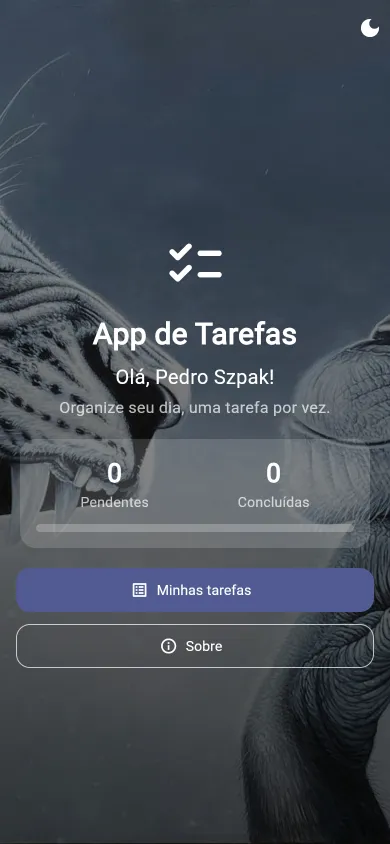
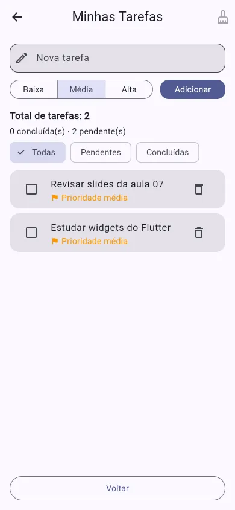
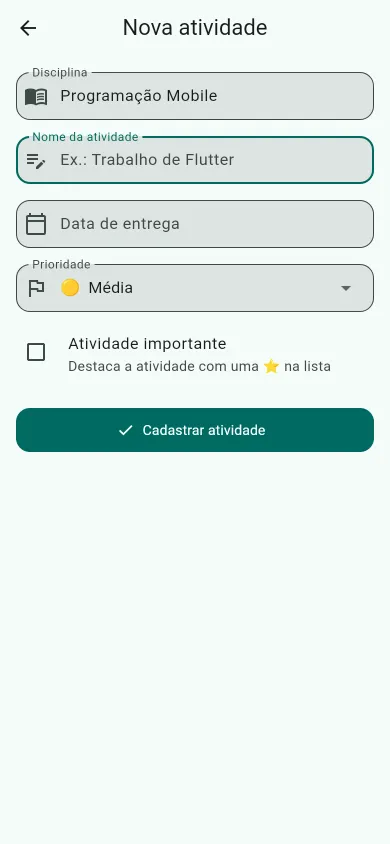
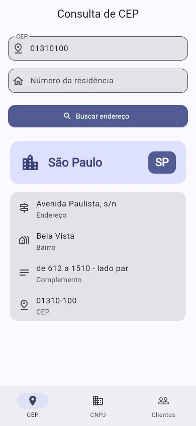
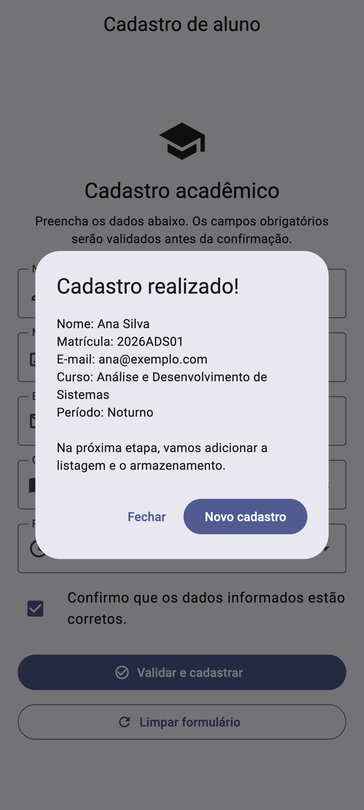
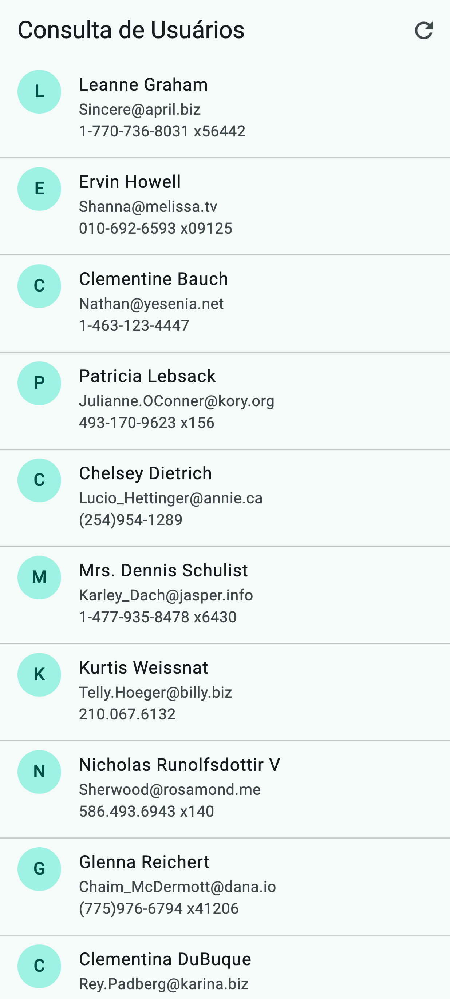

# Flutter Class

Exercícios da disciplina **Tecnologias Móveis e Híbridas** (ADS, Senac São José dos Pinhais), em Flutter e Dart. Cada pasta é um app Flutter independente. Os projetos maiores ficam em repositórios próprios, com link na tabela.

| Pasta | Exercício | O que tem |
|---|---|---|
| `1stClass/` | Primeira aula | Lista de personagens do Cocoricó com cards e avatares |
| `secondproject/` | App de Tarefas | Início com imagem de fundo e nome do usuário; tela de tarefas com campo, botão Adicionar e contador; tela Sobre com nome, curso, disciplina e imagem |
| `thirdproject/` | Aplicativo de Tarefas V2 | Três telas (Início, Tarefas, Sobre) com fundo, nome do usuário, lista, contador, editar e concluir tarefas |
| `fourthproject/` | StudyFlow | Atividades de estudo com disciplina, data de entrega, prioridade (Dropdown), importante (Checkbox) e status; telas de cadastro e detalhes com Navigator; concluir e excluir |
| `cadastro_academico/` | Exercício 09/10 + ADO | Campo Matrícula (obrigatório, mínimo de 5 caracteres, exibido na confirmação), 3 casos inválidos e 1 válido testados; funções dos slides marcadas com `ADO:` |
| Repositório [explorador-movel](https://github.com/PeSzpak/explorador-movel) | Aula 07: Explorador Móvel | Localização com mapa e marcador, câmera com foto e velocidade por GPS em km/h, com tratamento de permissões e falhas |
| Repositório [cadastro-alunos-supabase](https://github.com/PeSzpak/cadastro-alunos-supabase) | Aula 08: Flutter + Supabase | Cadastro de alunos com validação, INSERT, listagem (SELECT), e-mail único no banco e proteção para produção |
| `consulta_usuarios/` | Aula 09: APIs e APK | Consulta à JSONPlaceholder com carregamento, erro e lista vazia; APK release gerado e testado no emulador |
| `fifthproject/` | Consumo de APIs | Consulta de CEP (ViaCEP) e CNPJ (BrasilAPI) e cadastro de clientes em memória |
| `sixthproject/` | Consumo de APIs + Supabase | O `fifthproject` com os clientes salvos numa tabela do Supabase |

Os projetos novos têm um `README.md` próprio e as capturas de tela em `prints/`. Os APKs ficam nas [releases](https://github.com/PeSzpak/flutter-class/releases) do repositório.

## Telas

Capturadas do build web (`flutter build web`) com dados fictícios. Os prints dos projetos mais novos ficam no `prints/` de cada pasta.

| Tarefas V2: início | Tarefas V2: lista | StudyFlow: cadastro | CEP e CNPJ: consulta |
|---|---|---|---|
|  |  |  |  |

| Cadastro acadêmico | Consulta de usuários |
|---|---|
|  |  |

## Rodar qualquer projeto

```bash
cd <pasta>
flutter pub get
flutter test
flutter run          # ou: flutter run -d chrome
```

O `sixthproject/` precisa de um `supabase.json` (veja o README dele). Os demais rodam sem chave nenhuma; o `fifthproject/` e o `consulta_usuarios/` usam APIs públicas (ViaCEP, BrasilAPI, JSONPlaceholder).
