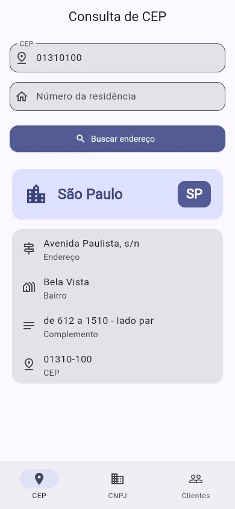

# Consumo de APIs: CEP, CNPJ e clientes

App com três abas (`NavigationBar`):



- **CEP:** busca o endereço na [ViaCEP](https://viacep.com.br) (`https://viacep.com.br/ws/{cep}/json/`).
- **CNPJ:** busca a empresa na [BrasilAPI](https://brasilapi.com.br) (`https://brasilapi.com.br/api/cnpj/v1/{cnpj}`).
- **Clientes:** cadastro com nome, CPF (11 dígitos), e-mail e telefone, guardado em memória. A versão que salva no Supabase é o [`sixthproject/`](../sixthproject).

As chamadas HTTP ficam em `lib/consulta_service.dart` (pacote `http`), com mensagens para CEP incompleto ou não encontrado, CNPJ inválido (dígitos verificadores conferidos no app) e falta de internet. As duas APIs são públicas e não pedem chave.

```bash
flutter pub get
flutter test
flutter run   # ou: flutter run -d chrome
```
