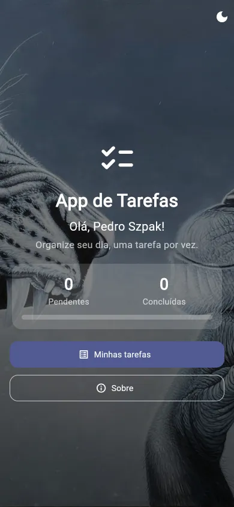
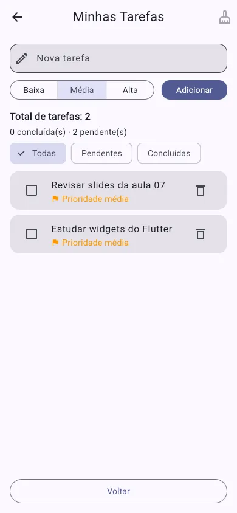

# Aplicativo de Tarefas V2

Evolução do [`secondproject/`](../secondproject): três telas (Início, Tarefas, Sobre) com estado compartilhado.

| Início | Tarefas |
|---|---|
|  |  |

- Prioridade Baixa, Média ou Alta (`SegmentedButton`) ao criar e ao editar.
- Concluir com checkbox, editar em diálogo, excluir com aviso no SnackBar.
- Filtros Todas, Pendentes e Concluídas, e contador de concluídas e pendentes.
- Tema claro e escuro alternado pelo botão no canto da tela inicial.
- Modelo em `lib/tarefa.dart`; as tarefas ficam em memória.

```bash
flutter pub get
flutter test
flutter run   # ou: flutter run -d chrome
```
